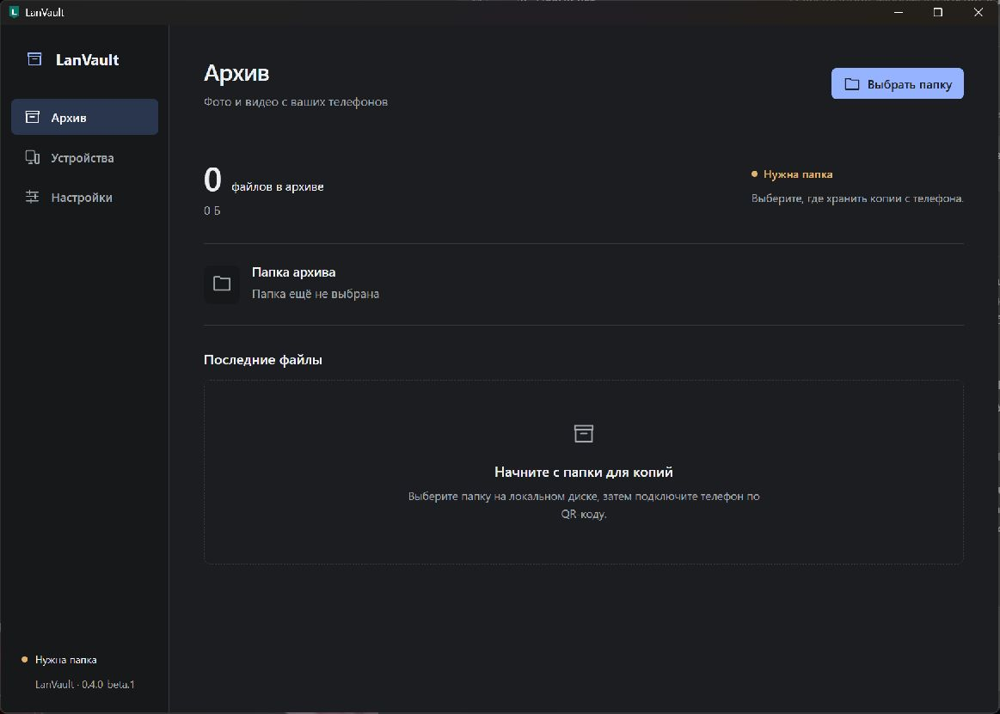

# LanVault

Copy original photos and videos from Android to a folder on your Windows PC over your home network. No cloud, no recompression. Originals stay on your phone.

[Русский](README.md) · [Download beta](https://github.com/Sharko-21/LanVault/releases/tag/v0.4.0-beta.1) · [Report a bug](https://github.com/Sharko-21/LanVault/issues/new/choose)

## Download

**0.4.0-beta.1 is a public beta.** Core scenarios are tested; broader device testing is ongoing. Keep an additional backup of important files. The app interface is currently in Russian.

| Download                                                                                                                       | Install                                                                                                    |
| ------------------------------------------------------------------------------------------------------------------------------ | ---------------------------------------------------------------------------------------------------------- |
| [Windows x64 ZIP](https://github.com/Sharko-21/LanVault/releases/download/v0.4.0-beta.1/LanVault-0.4.0-beta.1-windows-x64.zip) | Extract the entire archive to a permanent location. Run `lanvault-desktop.exe`, keeping its DLL beside it. |
| [Android APK](https://github.com/Sharko-21/LanVault/releases/download/v0.4.0-beta.1/LanVault-0.4.0-beta.1-android.apk)         | Install on Android 10+. Install compatible updates over the existing app to preserve pairing.              |
| [SHA256SUMS.txt](https://github.com/Sharko-21/LanVault/releases/download/v0.4.0-beta.1/SHA256SUMS.txt)                         | Verify integrity with `Get-FileHash <file> -Algorithm SHA256`.                                             |

Requirements: Android 10+, Windows 10/11 x64 with WebView2, a local NTFS archive and a shared home network. Windows beta is **unsigned** and may trigger SmartScreen; Android APK uses a permanent release signer. Checksums establish integrity, not publisher identity.

## First connection

1. On your PC, select an archive folder and enable receiving on your private home network.
2. On Android, grant photo/video access. Android 14+ needs access to all photos and videos for the full available library.
3. Open “Подключить телефон” on Windows, scan its QR code on Android, compare the codes, and approve on the PC.
4. Start copying. The trusted PC is saved for subsequent connections.

Closing the Windows window keeps the receiver in the system tray. Use “Выйти” to quit. Internet access is not required for transfer.



_Actual Windows first run, captured with separate empty state and no personal data._

## Features

- The full photo/video library available through Android MediaStore, plus manual selection.
- Up to four parallel transfers, progress and history.
- Automatic reconnect and background attempts within Android's OS restrictions.
- TLS with a pinned local CA, per-device revocable trust, Windows DPAPI and Android Keystore.
- Full SHA-256 verification and durable publication without overwriting archived files.
- “Проверить и восстановить копии”: verify and repair missing or corrupt PC copies of media still available on the phone.

Normal copying may reuse confirmations for up to a day. Explicit verification bypasses this cache. Interrupted files restart from the beginning. Archive files retain their original metadata and are not additionally encrypted by LanVault.

## Updates and network issues

Install APK updates over the existing app; retain the Windows state directory, identity, archive and shortcut arguments. Both apps have been upgraded on the original Pixel/Windows setup with copying continuing without another QR scan.

Both devices must share a local network. Guest Wi-Fi isolation may block connectivity. VPN software must permit direct LAN traffic on both devices; its kill switch may block LanVault. A manual Windows firewall helper is included for the exact EXE, TCP 43827, Private profile and LocalSubnet. See `INSTALL.md` in the Windows ZIP. Do not expose this port to the internet.

Background copying depends on Android battery and service restrictions. Check the notification and use “Скопировать сейчас” to start a foreground attempt.

## Build and contribute

Stack: Kotlin/Compose, React/TypeScript/Tauri, Rust/SQLite. Toolchain: Node.js 24, pnpm 11.25.0, Python 3.11+, Rust 1.94.0, JDK 17 and Android SDK 37 / Build Tools 36.0.0. Windows builds also need Visual Studio C++ Build Tools, Windows SDK and WebView2.

```powershell
git clone https://github.com/Sharko-21/LanVault.git
cd LanVault
pnpm install --frozen-lockfile
pnpm check
pnpm build:desktop
.\android\gradlew.bat -p android :app:assembleRelease :app:lintRelease testDebugUnitTest :core:model:test :core:transport:test
```

The Windows executable is in `target/release/`. Android release builds are unsigned until you apply your own signing key. Forks signed with a different key cannot update official installations. Production private keys and user state are not included in this repository.

Documentation below is currently in Russian:

- [Installation and updates](docs/installation/beta.md)
- [Development setup](docs/installation/development.md), [contributing and tests](CONTRIBUTING.md)
- [Release signing and packaging](docs/installation/releasing.md)
- [Security model and vulnerability reporting](SECURITY.md)
- [Test matrix and remaining validation](docs/testing/beta-matrix.md)
- [Protocol](docs/protocol/api.md) and [machine-readable OpenAPI](docs/protocol/openapi.json)

See [Actions](https://github.com/Sharko-21/LanVault/actions) for current CI results. Broader physical-device, power-loss and background-behavior testing is still needed. Automated checks are not an independent security audit.

## License

[MIT](LICENSE). Third-party license texts are bundled in [THIRD_PARTY_NOTICES.txt](THIRD_PARTY_NOTICES.txt), the Windows ZIP and Android APK.
