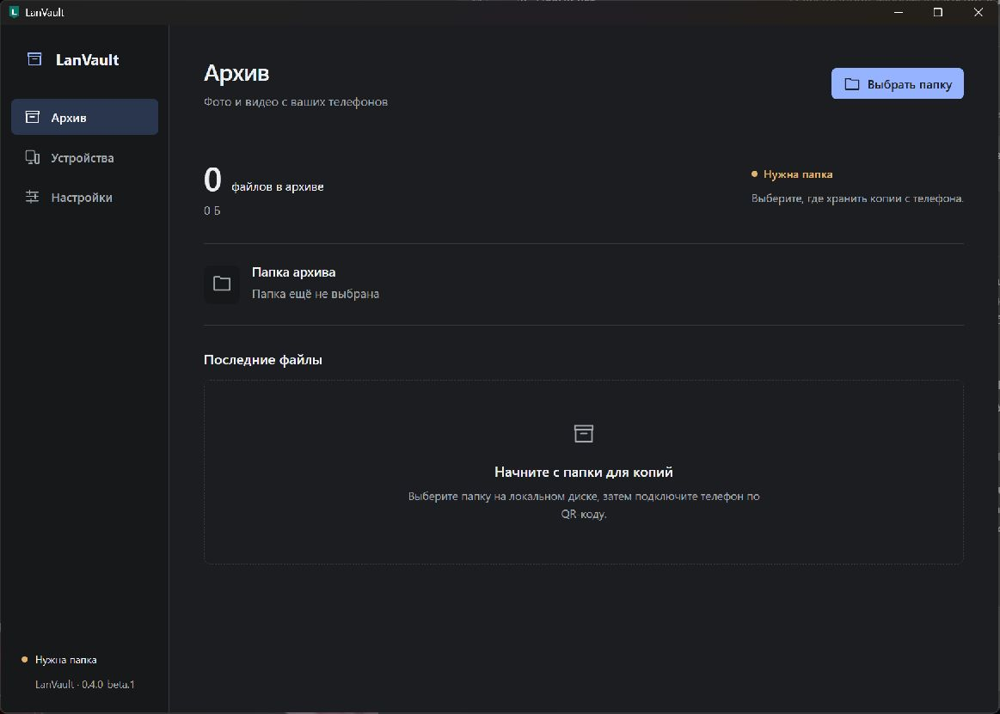

# LanVault

Оригиналы фото и видео с Android — в папку на вашем Windows-компьютере по домашней сети. Без облака и перекодирования, с сохранением оригиналов на телефоне.

[English](README.en.md) · [Скачать beta](https://github.com/Sharko-21/LanVault/releases/tag/v0.4.1-beta.1) · [Инструкция](docs/installation/beta.md) · [Сообщить о проблеме](https://github.com/Sharko-21/LanVault/issues/new/choose)

[](https://github.com/Sharko-21/LanVault/actions/workflows/ci.yml)

## Скачать и запустить

**Текущая версия: 0.4.1-beta.1.** Это публичная beta: основные сценарии проверены, испытания на разных телефонах продолжаются. Для важных файлов сохраняйте дополнительные резервные копии.

| Файл                                                                                                                           | Для чего                                                                                            |
| ------------------------------------------------------------------------------------------------------------------------------ | --------------------------------------------------------------------------------------------------- |
| [Windows x64 ZIP](https://github.com/Sharko-21/LanVault/releases/download/v0.4.1-beta.1/LanVault-0.4.1-beta.1-windows-x64.zip) | Распакуйте целиком в постоянную папку; запустите `lanvault-desktop.exe`. DLL должна остаться рядом. |
| [Android APK](https://github.com/Sharko-21/LanVault/releases/download/v0.4.1-beta.1/LanVault-0.4.1-beta.1-android.apk)         | Установите на телефон. При обновлении устанавливайте поверх предыдущей совместимой версии.          |
| [SHA256SUMS.txt](https://github.com/Sharko-21/LanVault/releases/download/v0.4.1-beta.1/SHA256SUMS.txt)                         | Контрольные суммы APK и архивов.                                                                    |

Нужны **Android 10+**, **Windows 10/11 x64 с WebView2**, локальный **NTFS-диск** и общая домашняя сеть. Интерфейс приложений сейчас на русском языке.

Windows beta не подписана Authenticode: возможны предупреждения SmartScreen. Android APK имеет постоянную release-подпись. Скачивайте файлы из Releases этого репозитория; хеш проверяйте командой `Get-FileHash <файл> -Algorithm SHA256`. Хеш подтверждает целостность, а не личность издателя.

### Первое подключение

1. **На компьютере:** выберите папку для архива и включите приём в частной домашней сети.
2. **На телефоне:** разрешите доступ к фото и видео. Для полной медиатеки на Android 14+ выберите доступ ко всем фотографиям и видео.
3. **Соедините устройства:** откройте «Подключить телефон» на ПК, отсканируйте QR в Android-приложении, сравните коды и подтвердите подключение на ПК.
4. **Запустите копирование.** При следующих запусках используется сохранённый компьютер; повторный QR не нужен.

Закрытие окна Windows оставляет приёмник в системном трее. Настройки и папка сохраняются. Для полного завершения выберите «Выйти» в трее. Интернет для передачи не требуется.



_Первый запуск Windows-приложения, отдельное пустое состояние без личных данных._

## Что умеет

- Копировать всю доступную Android MediaStore-медиатеку и отдельно выбранные фото/видео.
- Передавать оригиналы без сжатия, до четырёх файлов параллельно, с прогрессом и историей.
- Автоматически находить сохранённый компьютер и запускать фоновые попытки копирования в пределах ограничений Android.
- Проверять SHA-256 перед сохранением, публиковать файлы без перезаписи существующего архива.
- Проверять и восстанавливать утраченные или повреждённые копии командой **«Проверить и восстановить копии»**.
- Хранить отдельное доверие для каждого телефона и отзывать доступ с компьютера.

## Обновление и сохранность данных

Устанавливайте APK **поверх** текущего приложения. Сохраняйте каталог состояния Windows, его identity, папку архива и аргументы ярлыка. При совместимом обновлении подключение остаётся прежним. Обновление обеих сторон без нового QR проверено на исходном Pixel и Windows-ПК.

Оригиналы на телефоне сохраняются. Обычное копирование использует подтверждения до суток для быстрого повторного прохода. Команда проверки запрашивает полный SHA-256 на ПК, обходя этот кеш; она восстанавливает файлы, оригиналы которых ещё доступны на телефоне. Существующий архив не перезаписывается.

[Подробности установки, обновления и переноса](docs/installation/beta.md) · [Изменения beta](CHANGELOG.md)

## Если не подключается или копируется медленно

| Ситуация                                    | Что проверить                                                                                                                                                                                                                              |
| ------------------------------------------- | ------------------------------------------------------------------------------------------------------------------------------------------------------------------------------------------------------------------------------------------ |
| ПК недоступен                               | На ПК включён приём, выбрана доступная папка, оба устройства в одной локальной сети. Гостевой Wi-Fi и изоляция клиентов могут блокировать связь.                                                                                           |
| Включён VPN                                 | Разрешите локальную сеть в VPN на обоих устройствах. LanVault использует прямое локальное соединение; сторонний kill switch может его заблокировать. Дополнительный адаптер ASTER описан в [интеграции](integrations/aster-lan/README.md). |
| Windows блокирует входящее соединение       | В пакете есть ручной `setup-firewall.ps1`: точный EXE, TCP 43827, профиль Private, LocalSubnet. Инструкция находится в `INSTALL.md`. Отключать брандмауэр не требуется.                                                                    |
| На телефоне видна часть библиотеки          | Проверьте доступ ко всем фото и видео; приложение читает медиа, доступные через MediaStore.                                                                                                                                                |
| Копирование остановилось в фоне             | Проверьте уведомление LanVault и ограничения батареи Android; попробуйте «Скопировать сейчас».                                                                                                                                             |
| Большой файл после обрыва начинается заново | В этой beta повторяется весь файл. Скорость зависит от Wi-Fi, диска и размера файлов; параллелизм уже ограничен четырьмя передачами.                                                                                                       |

## Защита и границы beta

Подключение подтверждается на ПК. Передача использует TLS с проверкой локального CA и отдельный отзываемый токен устройства. Доверие защищено DPAPI на Windows и Keystore на Android. Файл получает подтверждение после проверки полного SHA-256 и устойчивого сохранения.

Архив хранит обычные оригинальные файлы, включая исходные метаданные; дополнительного шифрования архива средствами LanVault нет. Порт предназначен для локальной сети. Полная матрица телефонов, фоновой работы и потери питания ещё не завершена. Автотесты не заменяют независимый аудит безопасности.

[Модель безопасности и приватное сообщение об уязвимости](SECURITY.md) · [Фактическая матрица испытаний](docs/testing/beta-matrix.md)

## Разработка

Стек: **Kotlin / Compose** на Android, **React / TypeScript / Tauri** на Windows, **Rust / SQLite** в приёмнике.

| Каталог                         | Содержимое                                               |
| ------------------------------- | -------------------------------------------------------- |
| `android/app`, `android/core/*` | MediaStore, Room, Keystore, HTTPS и фоновые задачи       |
| `desktop`                       | Интерфейс Windows и оболочка Tauri                       |
| `crates`                        | Сервер, протокол, каталог, NTFS и платформенные адаптеры |
| `protocol`                      | Схемы и совместимые примеры                              |
| `tooling`                       | Сборка, тесты, подпись и упаковка                        |

Нужны Node.js 24, pnpm 11.25.0, Python 3.11+, Rust 1.94.0, JDK 17, Android SDK 37 / Build Tools 36.0.0. Для Windows — Visual Studio Build Tools C++, Windows SDK и WebView2.

```powershell
git clone https://github.com/Sharko-21/LanVault.git
cd LanVault
pnpm install --frozen-lockfile
pnpm check
pnpm build:desktop
.\android\gradlew.bat -p android :app:assembleRelease :app:lintRelease testDebugUnitTest :core:model:test :core:transport:test
```

Windows EXE: `target/release/lanvault-desktop.exe`. Android `assembleRelease` создаёт неподписанный APK; приватный ключ в исходники не включён. Для веб-интерфейса: `pnpm dev` → `http://127.0.0.1:1420`; системные функции доступны в Tauri (`pnpm dev:desktop`).

[Настройка окружения](docs/installation/development.md) · [Участие и проверки](CONTRIBUTING.md) · [Подпись и выпуск](docs/installation/releasing.md) · [API](docs/protocol/api.md)

CI собирает и проверяет Windows/Android, реальный HTTPS, зависимости и секреты; instrumentation настроен на API 29/35. Актуальный статус смотрите в [Actions](https://github.com/Sharko-21/LanVault/actions). Ручной workflow выпуска использует отдельные secrets подписи и создаёт черновик prerelease.

## Лицензия

[MIT](LICENSE). Лицензии сторонних библиотек: [THIRD_PARTY_NOTICES.txt](THIRD_PARTY_NOTICES.txt).
