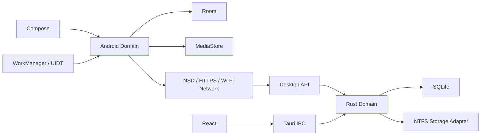

# Архитектура, утверждённая 4 ноября 2026

Android: Kotlin, Compose Material 3, ViewModel/Flow, Room, MediaStore, WorkManager и UIDT для подходящих пользовательских передач. Desktop: Tauri 2, React/TypeScript, Rust, SQLite и HTTPS API. Передача только Android → Windows, без облака.

Инварианты утверждённого проекта:

1. Оригинальные байты, без сжатия/перекодирования; отдельно учитывается доступ Android к EXIF и исходному формату.
2. Первоначальное доверие через QR; обнаружение не является доказательством доверия.
3. Отдельный токен устройства поверх проверенного TLS.
4. Части по 8 МиБ с устойчивым offset; ограниченный параллелизм.
5. COMMITTED только после полного SHA-256, публикации файла и устойчивого подтверждения.
6. Имена клиента не являются путями записи; завершённые файлы не перезаписываются.
7. Удаление на телефоне не удаляет копию.
8. Смена хранилища меняет datasetId либо выполняется как журналируемый перенос.
9. Фоновые запуски подчиняются ограничениям ОС; нет обещания непрерывной работы.
10. Привязка к разрешённым интерфейсам и Wi-Fi Network; без обхода через мобильную сеть.

На этапе 3 реализован Desktop MVP: сервер, SQLite-каталог, NTFS-адаптер и Tauri IPC. [Отчёт и ограничения](../stages/stage-03.md), [уточнения MVP](../adr/0013-desktop-mvp.md). Полнофайловая передача с `resumable:false` предшествует частям и устойчивому offset этапа 6. На этапе 4 добавлены MediaStore, ручная Android-передача, Keystore и Room-журнал. JVM-ядро `core:transport` проверяется против настоящего Windows-сервера; Android-адаптер `core:network` привязывает его к Wi-Fi Network. Обнаружение NSD/mDNS, планировщик и автоматизация остаются отдельными этапами. [ADR-0014](../adr/0014-android-mvp.md), [отчёт этапа 4](../stages/stage-04.md).
